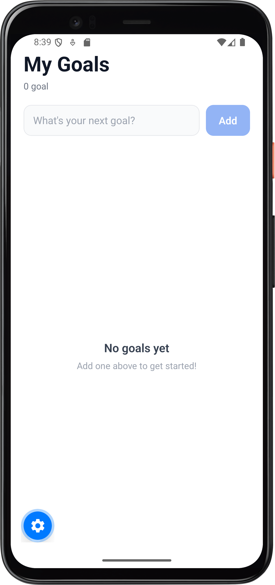
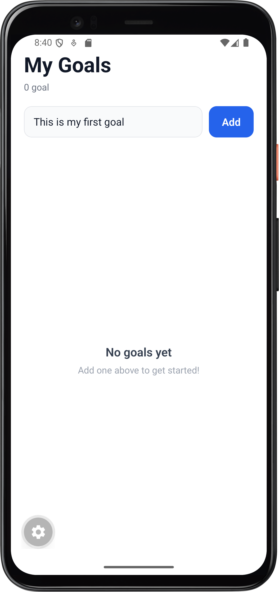
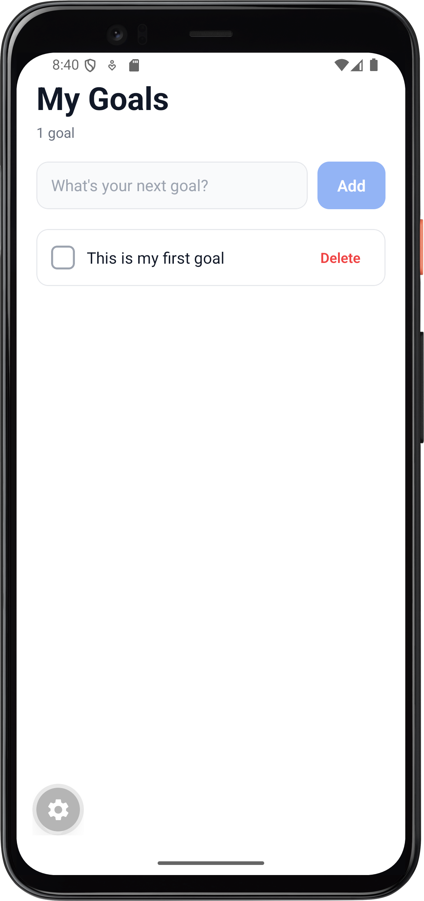
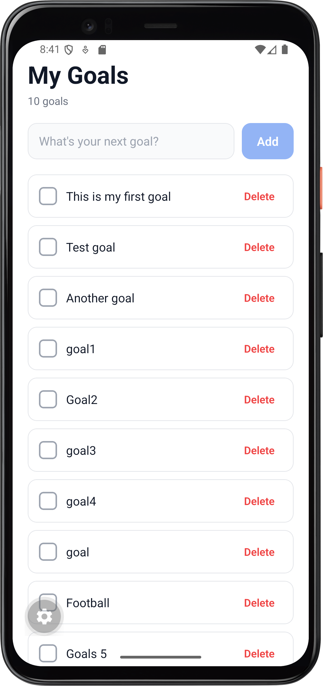
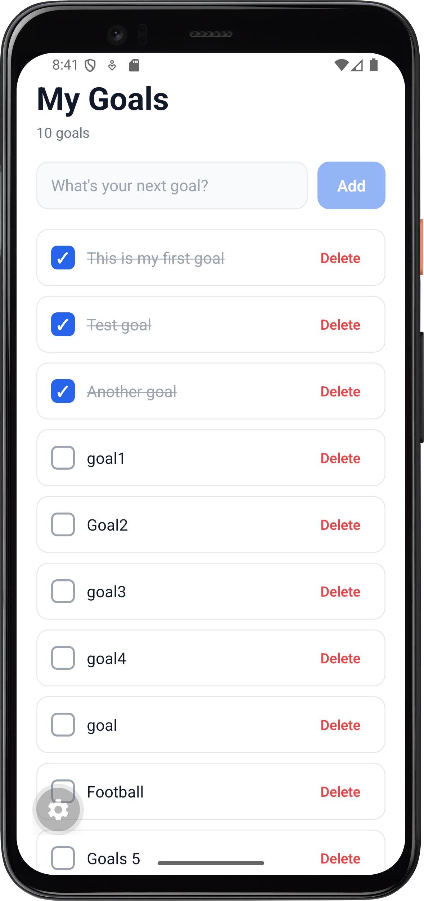

# Goals App

A simple, clean goal-tracking mobile app built with **Expo** and **React Native**. Add your goals, mark them as complete, and delete them when you're done — all with a fast, native-feeling interface.

## Features

- **Add goals** — quickly capture a new goal from the input field.
- **Mark as complete** — tap a goal to toggle its completed state (strikethrough style).
- **Delete goals** — remove goals you no longer need.
- **Live goal counter** — the header always shows how many goals you have.
- **Empty state** — a friendly prompt when there are no goals yet.
- **Cross-platform** — runs on iOS, Android, and the web via Expo.

## Screenshots

| Empty State | User Input | Add Goal |
| --- | --- | --- |
|  |  |  |

| List of Goals | Marked Goals |
| --- | --- |
|  |  |

> Note: the filenames above must match the files in `assets/screenshots/`.

## Tech Stack

- [Expo](https://docs.expo.dev/) `~57.0.27`
- [React Native](https://reactnative.dev/) `0.86.3`
- [React](https://react.dev/) `19.2.3`
- Styling with React Native `StyleSheet`

## Project Structure

```
Goals_app/
├── App.js                  # Root component and app state
├── index.js                # Entry point (registerRootComponent)
├── app.json                # Expo app configuration
├── assets/
│   ├── screenshots/        # App screenshots used in this README
│   └── ...                 # Icons and splash assets
└── src/
    └── components/
        ├── EmptyState.js   # Shown when there are no goals
        ├── GoalInput.js    # Text input + add button
        ├── GoalItem.js     # Single goal row (toggle + delete)
        └── GoalList.js     # Renders the list of goals
```

## Getting Started

### Prerequisites

- [Node.js](https://nodejs.org/) installed
- The [Expo Go](https://expo.dev/go) app on your phone (or an iOS/Android simulator)

### Installation

```bash
npm install
```

### Run the app

```bash
npm start        # start the Expo dev server
npm run android  # open on Android
npm run ios      # open on iOS
npm run web      # open in the browser
```

## How It Works

`App.js` holds the goal state and passes callbacks down to the components:

- `GoalInput` collects a new goal and calls `addGoal`.
- `GoalList` renders each `GoalItem` or the `EmptyState` when the list is empty.
- `GoalItem` calls `toggleGoal` when tapped and `deleteGoal` on delete.

## Available Scripts

| Script | Description |
| --- | --- |
| `npm start` | Start the Expo development server |
| `npm run android` | Start the dev server and open on Android |
| `npm run ios` | Start the dev server and open on iOS |
| `npm run web` | Start the dev server and open in the browser |
| `npm run lint` | Run ESLint via `expo lint` |

## Contributing

Contributions are welcome. Fork the repo, create a feature branch, and open a pull request.

## License

This project is licensed under the MIT License — see the [LICENSE](LICENSE) file for details.
